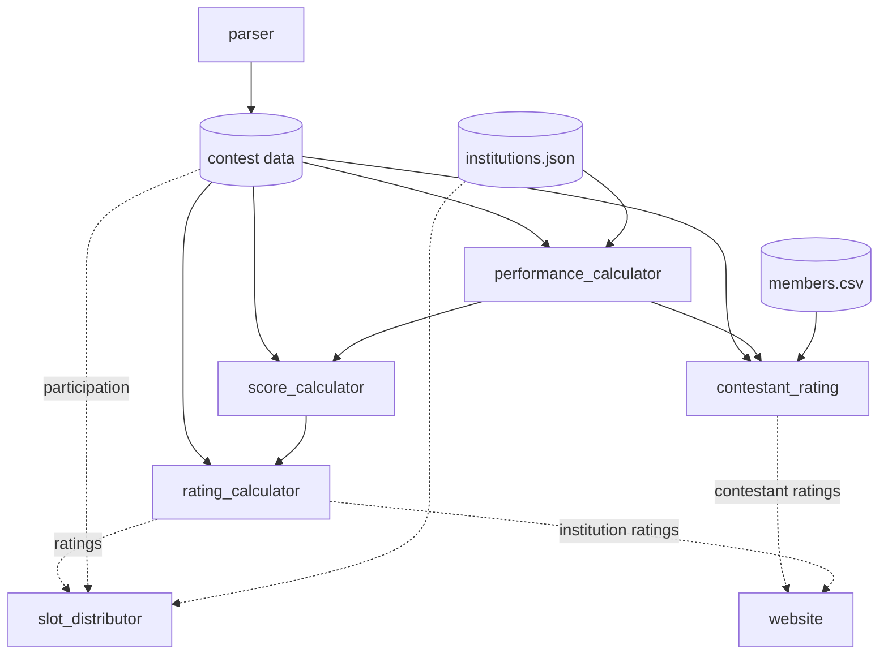

# Biscuit Rating

Rates institutions and individual contestants from programming contest
standings, distributes contest slots using institution ratings, and publishes
a rating website.

1. The **parser** turns saved standings HTML into contests.
2. The **performance calculator** gives every team a performance.
3. The **score calculator** combines an institution's teams into one score per contest.
4. The **rating calculator** combines scores over time into a rating.
5. The **slot distributor** allocates a contest's slots using ratings, recent
   participation, and the slots each institution registered for.
6. The **individual rating** credits each team's performance to its members
   and rates every contestant.
7. The **website** publishes the individual ratings, with a page per person.

The **contests** and **institution finder** modules own the contest data and
the institution names. The **`biscuit`** command ties everything together.

## Installation

You need Python 3.10 or newer, and a terminal open in this repository. Use
either plain Python or Anaconda.

### Python

```bash
python -m venv .venv
source .venv/bin/activate        # Windows: .venv\Scripts\activate
python -m pip install -e ".[test]"
```

### Anaconda

```bash
conda env create -f environment.yml
conda activate biscuit-rating
```

Both install the `biscuit` command. Activate the environment in every new
terminal. Run all commands from the repository root. If the `biscuit` command
isn't found, `python -m biscuit` works the same way.

## Usage

For complete walkthroughs, see [Step-by-step guides](#step-by-step-guides).

### Regenerate the data

```bash
biscuit update            # validate the inputs, then rerun whatever is out of date
biscuit update --check    # list out-of-date steps; exit 1 if any
biscuit update --force    # rerun everything
biscuit update --graph    # print the dependency graph
```

`biscuit update` first validates the inputs:

- contest names, dates, parsers, and standings files
- every contest has a credit, and every credit belongs to a contest
- every institution name is uppercase and belongs to exactly one institution

It then reruns only the steps whose inputs changed (see
[How it fits together](#how-it-fits-together)). Run it after changing any input.

### Add a contest

```bash
biscuit add-contest --html "path/to/standings.html" \
  --name "IUT 2026" --date 2026-07-25 --parser TOPH --credit 1
biscuit update
biscuit check-institutions --contest "IUT 2026"
```

- **`--html`:** pass every page of a multi-page standings, in order.
- **`--parser`:** `TOPH` or `BAPS`.
- **`--credit`:** weights the contest in the ratings. The default is `1`, and
  ICPC regionals use `3`, so they count three times as much.
- **`--standings`:** the public standings page, linked from the "Get listed"
  form. By default it is the address the browser saved the HTML from.

`check-institutions` lists institution names in the standings that the
database does not know. Teams with such names are left out of the ratings.
Fix them with the commands below, then run `biscuit update` again.

### Manage institutions

```bash
biscuit add-institution "EXAMPLE UNIVERSITY"
biscuit add-alt-name "EXAMPLE UNIVERSITY" "EXAMPLE UNIV."
biscuit check-institutions --interactive
```

An alternate name is any other spelling of an institution, including typos in
standings. The standings files are never edited. The interactive mode shows
each unknown name with its closest matches. For each one, you choose: save it
as an alternate name, add it as a new institution, or skip it. Afterwards it
runs `biscuit update`.

### Distribute slots

1. Create `slot_distributor/input/registered.csv` with the columns
   `Institution,Max Slots`.
2. Create `slot_distributor/input/options.json`.

Copy both formats from `slot_distributor/input/example/`. The input folder is
git-ignored. Then run:

```bash
biscuit distribute
biscuit distribute --interactive
```

The result is in `slot_distributor/output/`:

- `slots.xlsx` is for organizers.
- `slots.csv` and `waiting_list.csv` hold the same results as plain CSV.

If a registered name is unknown, `biscuit distribute` stops and writes
`missing.csv` with suggestions. `--interactive` prompts instead. For each
name, you can save it as an alternate name, fix it as a typo in
`registered.csv` only, or add a new institution. See
[slot_distributor/README.md](slot_distributor/README.md) for the algorithm and
options.

### Rate individuals and build the website

Team members go in `members/data/members.csv`, one row per team:

```csv
contest,institution,team_name,member1,member2,member3
ICPC 2025,UNIVERSITY OF DHAKA,DU_Team,handle_a,handle_b,
```

`contest`, `institution` and `team_name` must match the parsed standings;
`biscuit update` checks every row and suggests close team names. A `NULL` member
cell means the handle was not provided; people without a Codeforces handle are
left out. `biscuit complete-members` adds a `NULL` row for every team that has no
row yet and sorts the file by institution, contest date, and team name, so a
new contest's teams are ready to fill in.

Contestants list themselves on the site's **Get listed** page
(`form.html`). It checks their Codeforces handle, then asks for their team in
each contest from their institution's teams in the standings, with optional
teammates' handles, also checked on Codeforces. Answers go to a Google Form you
own (see [Set up the Get listed form](#step-by-step-guides)); until one is
connected, the page saves the answers as a CSV file to send instead. Review
and import them with:

```bash
biscuit import-form responses.csv           # show what would be added and what needs a look
biscuit import-form responses.csv --apply   # write it to members.csv
```

A handle fills its team's first free member cell. Handles already on another
team in that contest, full teams, and team names not in the standings are
listed for you to settle by hand. A person's latest response replaces their
earlier ones. Then:

```bash
biscuit fetch-codeforces      # cache names and photos of newly listed handles
biscuit update                # rate everyone
biscuit site --serve          # build the site and preview it at http://127.0.0.1:8000/
```

`biscuit site` alone writes the site to `website/output/` without serving it.
Codeforces profiles are cached in `codeforces/data/users.json`;
`biscuit fetch-codeforces --refresh` fetches all of them again.

Each person has one handle. List people with several accounts under their main
one only. `biscuit fetch-codeforces` rewrites any handle Codeforces now spells
differently (a renamed account, or other letter case) to the current handle
throughout `members.csv`. Renames of handles fetched earlier show up with
`--refresh`, which CI runs on every push to the default branch.

### Run the tests

```bash
python -m pytest
```

## Step-by-step guides

<details>
<summary><b>A contest just took place: add its data</b></summary>

<br>

The example contest is "XYZ 2026", held on 2026-10-15.

**1. Save the standings page.** Open the final standings in a browser and save
the page (Ctrl+S, "Webpage, HTML only" is enough) as, for example,
`XYZ26.html`. If the standings span several pages, save each one, for example
`XYZ26 - Page 1.html` and `XYZ26 - Page 2.html`. Note which site it is from:
Toph (parser `TOPH`) or BAPS, `bapsoj.org` (parser `BAPS`).

**2. Open the project environment** and start from the latest data:

```bash
source .venv/bin/activate        # or: conda activate biscuit-rating
git pull
```

**3. Register the contest:**

```bash
biscuit add-contest --html ~/Downloads/XYZ26.html \
  --name "XYZ 2026" --date 2026-10-15 --parser TOPH --credit 1
```

This copies the HTML into `parser/input/contest_files/`, adds the contest to
`parser/input/contests.json`, and gives it a credit in
`rating_calculator/input/credits.json`. For multiple pages, list them all
after `--html`, in order. Use credit `1` for a normal IUPC; ICPC regionals
use `3`, so they count three times as much.

**4. Regenerate the ratings:**

```bash
biscuit update
```

**5. Fix institution names.** Teams whose institution is unknown are left out
of the ratings, so check:

```bash
biscuit check-institutions --contest "XYZ 2026"
```

If it prints "Every institution name resolves", go to step 6. Otherwise, run:

```bash
biscuit check-institutions --contest "XYZ 2026" --interactive
```

For each unknown name it shows the closest matches. Pick one:

| Choice | Meaning |
| --- | --- |
| `1`, `2` or `3` | It is that institution, written differently. The spelling is saved as an alternate name, so future contests recognize it too. |
| `n` | It is a new institution. It is added to the database. |
| `o` | It is another institution. Type that institution's name. |
| `s` | Skip it. Use this for names that aren't institutions, like `IOI`, `TEMP UNIVERSITY`, or an empty name. |

Afterwards it runs `biscuit update` for you. The same fixes can be made one at a
time:

```bash
biscuit add-alt-name "INTERNATIONAL ISLAMIC UNIVERSITY CHITTAGONG" "INTERNATIONAL ISLMAIC UNIVERSITY CHITTAGONG"
biscuit add-institution "NEW UNIVERSITY NAME"
biscuit update
```

**6. Check the result:**

```bash
biscuit update --check
git diff --stat
```

The new ratings are in `rating_calculator/output/latest_ratings.csv`. Running
`git diff` on that file shows whose rating changed.

**7. Commit and push:**

```bash
git add -A
git commit -m "Add XYZ 2026"
git push
```

If step 4 is forgotten, or names are fixed later on GitHub, CI regenerates the
data on the main branch and commits it.

**With Claude Code:** say *"add this contest: ~/Downloads/XYZ26.html, held
today"*. The `add-contest` skill:

- detects the parser from the HTML
- asks for anything it can't work out, then runs steps 3 to 6
- shows every proposed institution fix together for approval before applying
  any of them

It doesn't commit unless asked.

</details>

<details>
<summary><b>Hosting a contest: distribute its slots</b></summary>

<br>

Slots are based on the ratings and participation history from past contests,
so the contest being hosted doesn't need to be in the data. Add it after it
takes place, as in the guide above.

**1. Get the latest data:**

```bash
source .venv/bin/activate        # or: conda activate biscuit-rating
git pull
biscuit update --check              # should say "All outputs are up to date."
```

If it lists stale steps, run `biscuit update` first.

**2. Write the registration list.** Create
`slot_distributor/input/registered.csv` with one row per institution and the
number of teams it registered:

```csv
Institution,Max Slots
UNIVERSITY OF DHAKA,5
ISLAMIC UNIVERSITY OF TECHNOLOGY,4
"BEGUM ROKEYA UNIVERSITY, RANGPUR",2
```

- **Names:** they don't have to match the database exactly. Known alternate
  spellings are recognized, and anything else is caught in step 4.
- **Commas:** put quotes around names that contain a comma.
- **Max Slots:** an institution never gets more slots than this, including its
  places on the waiting list. To cap every institution, for example at 3, write
  at most 3 here.

Registrations from a Google Form or a spreadsheet can be exported as CSV with
these two columns.

**3. Set the options.** Copy the example and edit it:

```bash
cp slot_distributor/input/example/options.json slot_distributor/input/
```

```json
{
  "distributor": "PRIORITY",
  "parameters": {
    "total_slots": 100,
    "waiting_list_size": 20,
    "min_unique": 30,
    "absence_bonus": 200,
    "max_missed_contests": 5
  }
}
```

| Option | Meaning |
| --- | --- |
| `total_slots` | How many teams the contest can host. |
| `waiting_list_size` | How many backup entries to list. |
| `min_unique` | At least this many different institutions are guaranteed one slot. |
| `absence_bonus`, `max_missed_contests` | An institution that missed the last *x* contests gets +200 × *x* (at most +1000) on its first slot. Leave these as they are unless the policy changes. |

Both files stay local (`slot_distributor/input/` is git-ignored), so
registration data never ends up in the repository.

**4. Run it:**

```bash
biscuit distribute --interactive
```

If every name is recognized, it goes straight to the result. For each name it
can't find, it shows the closest matches. Pick one:

| Choice | Meaning |
| --- | --- |
| `t1` | It is a typo. Fix only that row in `registered.csv`. Use this for one-off mistakes. |
| `1` | It is that institution under another name. Save it as an alternate name. Use this for spellings that will come up again. |
| `n` | It is a new institution. It gets a rating of 0 plus the full +1000 bonus for its first slot. |
| `s` | Skip it. The distributor stops and writes `missing.csv`, so it can be looked into before running again. |

If names were added to the database, it updates the ratings before
distributing.

It also stops if two rows turn out to be the same institution (for example
"BUET" and its full name), or if a `Max Slots` value isn't a positive whole
number. Fix the CSV and run it again.

**5. Read the result.** Everything is in `slot_distributor/output/`.
`slots.xlsx` is the file to share with organizers:

| Sheet | What it shows |
| --- | --- |
| **Read Me** | How the slots were calculated, in plain language. |
| **Slots** | Each institution's rating, missed contests, bonus, registered slots, and slots received. |
| **Waiting List** | The order in which freed or extra slots are handed out. |
| **Ratings** | The ratings that were used as input. |

`slots.csv` and `waiting_list.csv` hold the same results as plain CSV.

**6. Adjust by hand if needed.** In the **Slots** sheet, organizers can give
extra slots: enter a number in **Reserved Slots** (for example, for the host
institution) and the reason in **Explanation for Reserved Slots**. **Total
Slots** updates automatically. If a team drops out, or more teams can be
hosted, hand out the slots from the **Waiting List**, starting at position 1.

**7. Commit any database fixes.** Alternate names or institutions added in
step 4 belong in the repository:

```bash
git add institution_finder/data/institutions.json
git commit -m "Add institution names from XYZ 2026 registration"
git push
```

**With Claude Code:** say something like *"distribute slots for XYZ 2026,
here's the registration sheet: …"*. The `distribute-slots` skill will:

- turn the sheet into `registered.csv`
- ask for the options it doesn't have, offering the last values used as
  defaults
- run the distributor and show all proposed name fixes together for approval
- summarize who got fewer slots than they asked for, who got a bonus, and the
  start of the waiting list

</details>

<details>
<summary><b>Set up the Get listed form</b></summary>

The site's form sends answers to a Google Form, so they land in a Google Sheet
you own. Respondents never see the Google Form itself.

**1. Create the Google Form** at [forms.google.com](https://forms.google.com)
with four questions titled exactly `Name`, `Handle`, `Institution` (all
**Short answer**), and `Teams` (**Paragraph**, as it holds every contest's
answer). Leave them all optional and turn off "Collect
email addresses" and sign-in (Settings > Responses), so the site can post to
it.

**2. Find the question ids.** Open the menu (⋮) > **Get pre-filled link**,
type `x` in every question, and click **Get link**. The link looks like:

```text
https://docs.google.com/forms/d/e/FORM_ID/viewform?usp=pp_url&entry.111=x&entry.222=x&entry.333=x&entry.444=x
```

**3. Connect the site** by filling in `website/input/form.json`, replacing
`viewform` with `formResponse` and using the `entry.` numbers in question
order:

```json
{
  "action": "https://docs.google.com/forms/d/e/FORM_ID/formResponse",
  "entries": {
    "Name": "entry.111",
    "Handle": "entry.222",
    "Institution": "entry.333",
    "Teams": "entry.444"
  }
}
```

Run `biscuit site --serve`, submit a test answer at
http://127.0.0.1:8000/form.html, and check that it shows up under the Google
Form's **Responses**. Then commit `form.json`; the next deployment puts the
form live.

**4. Import answers.** In the Google Form's responses, click **Link to
Sheets**, then in the sheet use **File > Download > Comma-separated values**.
Then:

```bash
biscuit import-form ~/Downloads/responses.csv           # review
biscuit import-form ~/Downloads/responses.csv --apply   # write
biscuit fetch-codeforces && biscuit update                 # rate the new members
```

Settle the listed problems in `members/data/members.csv` by hand, and delete
the downloaded file: it holds respondents' names.

</details>

## How it fits together



Each step lists its input files: its own code and `input/` folder, plus the
outputs it reads. `biscuit update` fingerprints those files in `biscuit/state.json`
and reruns a step only when they change. Some examples:

- **New contest:** every step reruns.
- **New credit:** only the rating calculator reruns.
- **New alternate name:** the performance calculator reruns. Later steps
  rerun only if the name appears in some standings.

The slot distributor is not a step. Its registrations are private, so it runs
only when you call `biscuit distribute`.

### Modules

Each module is a package with one job and a small public API. The pipeline
modules have a single `run()` function and their own `input/` and `output/`
folders. Each package has a README describing it.

| Package | Job | Depends on |
| --- | --- | --- |
| `contests/` | contest records, their file format, loading and saving | — |
| `institution_finder/` | institution names | — |
| `parser/` | standings HTML to contests | `contests` |
| `performance_calculator/` | team performances | `contests`, `institution_finder` |
| `score_calculator/` | institution scores | `contests` (dates) |
| `rating_calculator/` | institution ratings | `contests` (dates) |
| `slot_distributor/` | slot allocation | `contests`, `institution_finder` |
| `members/` | team members (`members.csv`) and their validation | `contests` |
| `codeforces/` | cached Codeforces profiles | — |
| `contestant_rating/` | ratings of individual contestants | `contests`, `members`, `rating_calculator` (formula) |
| `website/` | static website: contestant and institution rankings, a page per contestant and per institution, and the "Get listed" form | `contests`, `codeforces`, `members`; reads the rating outputs |
| `biscuit/` | command line, update pipeline, validation | all of the above |

`contests`, `institution_finder`, `members` and `codeforces` are data modules:
they own their data's format and every other module reads that data through
them. `contestant_rating` reuses the rating calculator's formula rather than
duplicating it. Only the `biscuit` package ties modules together into a workflow,
and no module depends on `biscuit`.
The contest files are stored in `parser/output/contests/`, because the parser
produces them.

Each calculator and distributor is chosen by name in its `input/options.json`.
To add a new algorithm, subclass the interface in that module's
`calculators.py`, `distributors.py`, or `parsers.py`, and register it there.

## Automation

### Continuous integration

`.github/workflows/ci.yml` runs `biscuit update` and the tests on every push and
pull request. On the default branch it also commits any regenerated outputs.
So adding a contest, institution, alternate name, or team members is enough,
and the ratings follow automatically. On the default branch it also refreshes
every member's Codeforces profile, writes renamed handles back to
`members.csv`, and publishes the website to GitHub Pages (Settings > Pages >
Source must be set to "GitHub Actions").

### Agent skills

`.claude/skills/` holds two skills for Claude Code:

- `add-contest`: adds a contest's standings and resolves its unknown
  institutions.
- `distribute-slots`: runs the slot distributor, fixing misspelled or new
  institutions with your confirmation.

Both skills only run the `biscuit` commands above, so you can do everything they
do by hand.

## License

See [LICENSE](LICENSE).
